# Noema

Noema is a multi-tenant LLM intelligent gateway on Amazon Bedrock. Small, fast models answer typed decisions (choice, score,
yes/no) while a large model starts the answer, and those decisions steer the route, the reasoning effort and the
answer behavior of the turn. Every model call goes to Amazon Bedrock (Converse, ConverseStream and the Mantle
chat endpoint) in the tenant's own AWS account. Noema never calls any non-Bedrock model API (owner decision D1).

[](https://www.youtube.com/watch?v=t0STMATTbko)

Intro video: [Introduce Noema: small models decide; big models answer.](https://www.youtube.com/watch?v=t0STMATTbko)

## Architecture and data flow

<p align="center">
  
</p>

The animation follows one turn: ① the request is admitted at the API edge; ② the decision ensemble and a speculative
generation attempt start together; ③ when the decided spec agrees, the attempt commits and the answer streams back
over SSE (otherwise it restarts invisibly); ④ the turn is finalized and persisted. Media extraction and D4 labeling
run alongside. Details: [docs/architecture.md](docs/architecture.md).

The design is in `../docs/noema` (canonical, read-only for this repo). This repo is the Phase 1 implementation.

## Status: 0.1.0, Phase 1 MVP (tags `phase1-mvp` and `v0.1.0`)

The release gate re-ran the full regression on images built from the release tree, and `make check` is all green
([reports/qa/release-gate.md](reports/qa/release-gate.md), [reports/mvp-acceptance.md](reports/mvp-acceptance.md)).
As written, the 06 §11 Phase 1 exit gate is not fully met (K1, L1 at 200 streams per pod, and the NOT-RUN rows
below). The gate status is in
[reports/qa/wave-e-summary.md](reports/qa/wave-e-summary.md): of the 63 Phase 1 gate rows, **50 PASS, 1 FAIL,
12 NOT-RUN**. Every NOT-RUN row needs Phase 0 data, Bedrock spend, AWS accounts, production or the pre-GA pen test
by design. The failing row is **K1** (token estimator within 2%: 14 of 25 live calls). L1 (proxy overhead) passes
at the sized density and fails as written at 200 streams per pod. The pods are sized from the measured knee: 125 streams per
2-vCPU pod for the Wave F image (75 for the Wave E3 image), planned at 100 ([reports/perf/sizing.md](reports/perf/sizing.md)).

| Area | Done in Phase 1 | Not done (and why) |
|---|---|---|
| API | turns (SSE and JSON, cancel), `/v1/decisions` native and Jev-shaped, the OpenAI-compatible decisions facade, profiles, sessions, files and derivatives, usage, health, read-only admin (W4) | stream resume `GET /v1/turns/{id}/events` answers 501 (Phase 2); `x-aghoo-end-user` answers 422 (IMPL-033) |
| Decisions | `lightweight-model-decide` (default, D6) and `router-default`; logprob and verbalized members; backups; linear pool; hierarchical choice method (owner answer 2026-10-10); `router-plus` escalation; L2 cache | no in-turn escalation (IMPL-025); early commit off (R5); hierarchical on the facade and Jev is 422 |
| Generation | `single`, `fallback`, `race`; holdback; invisible restart; verification | `best_of_n`, `fuse`, `speculative`, `hedge` (422, Phase 2) |
| Tenancy and security | API keys, RLS, STS per (pod, tenant) with ExternalId, spotlighting, escaping, CSP UI | STS against real AWS accounts not run (moto only); pen test is pre-GA |
| Media | nsjail sandbox, images (HEIC to PNG), PDF sanitize, Docling Markdown, page images, Tesseract OCR | audio, video, SVG, DOCX (415) |
| Labeling and calibration | D4 consensus labeling, temperature and Platt calibrators, acceptance gate, two-person activation | no calibrator is active: live traffic is `uncalibrated` until Phase 0 labels exist |
| Ops | GCRA admission over every call, breakers, retry budget, outbox, jobs, retention, price catalog, cost meter, Prometheus metrics, alert rules and dashboards (`deploy/observability/`) | 24 h soak (1 h run), multi-pod load on shared datastores, Phase 0 gates |
| UI and SDKs | Web UI W1, W2, W4, W7 with a dev cookie proxy; TypeScript and Python SDKs | OIDC or BFF login (Phase 2) |

What is open is listed in [reports/mvp-acceptance.md](reports/mvp-acceptance.md) sections 7 and 8 and in
[CHANGELOG.md](CHANGELOG.md).

## Quickstart: from a clean checkout to a working turn

The local stack runs everything against the wire-level Bedrock mock (`tools/mockbedrock`) and moto. It makes no
Bedrock or AWS call. Requirements: Linux, Docker with Compose v2, `uv` 0.9 or later (it provides CPython 3.12),
network access for the first image build, and `jq` for the examples below. Node.js is not needed here (it is for
`make check` and the UI: [docs/development/setup.md](docs/development/setup.md)).

```bash
make help        # every target, with a one-line description
make sync-dev    # the locked dev dependency group into .venv (about 0.5 GB; `make sync` adds the 1.5 GB media group)
make e2e-up      # build the 3 images, start the stack "noema-e2e" (ports from 28100), seed it, wait until healthy
```

The first `make e2e-up` builds `noema-api` and `noema-worker` (372 MB each) and `noema-media` (2.9 GB), pulling
the base images and packages. `E2E_BUILD=0` reuses images that exist (`NOEMA_API_IMAGE`, `NOEMA_WORKER_IMAGE`,
`NOEMA_MEDIA_IMAGE` pick their tags).

`make e2e-up` writes the stack's endpoints, API keys and operator keys to `~/.noema/stacks/noema-e2e.json`
(mode 0600, outside the repo). Send a streamed turn with the `developer` key of tenant `t_acme`:

```bash
S=~/.noema/stacks/noema-e2e.json
KEY=$(jq -r '.tenants.t_acme.projects.main.principals.developer.key' $S)
API=$(jq -r '.endpoints.api[0]' $S)
curl -sN $API/v1/turns -H "Authorization: Bearer $KEY" -H 'Content-Type: application/json' -d '{"stream": true,
  "input": [{"role": "user", "content": [{"type": "input_text", "text": "What is the capital of France?"}]}]}'
```

The stream holds `turn.created`, `preflight.completed`, `route.selected`, `generation.started`,
`decision.completed`, `route.confirmed`, `generation.committed`, four `generation.delta` frames ("Paris is the
capital of France. It is also its largest city.", the mock's default answer), `generation.completed` and
`turn.completed`. Then:

```bash
make e2e-smoke   # the 8 smoke tests against the stack, every response contract-validated
make e2e-down    # stop the stack and delete its volumes
```

`make e2e-smoke` runs `make e2e-up` first, so it rebuilds the images unless you pass the same `E2E_BUILD=0` (and
image variables) as above.

Verification of this quickstart (2026-10-12): `make help` was run; `make sync-dev` was run as `uv sync --frozen`
into a separate environment (`UV_PROJECT_ENVIRONMENT=/tmp/wffix-venv`, 471 MB), which the stack steps used. The
image build inside `make e2e-up` was **not run** for this document. The rest was run on a stack of
its own with the Wave F images: `NOEMA_API_IMAGE=noema-api:wfinfra NOEMA_WORKER_IMAGE=noema-worker:wfinfra
NOEMA_MEDIA_IMAGE=noema-media:wfinfra make e2e-up E2E_BUILD=0 E2E_PROJECT=noema-wffix E2E_PORT_BASE=36300` (29 s),
the curl turn above (exactly the event list and text above), `make e2e-smoke` with the same variables (8 passed),
then `make e2e-down` (0 containers, volumes and networks left).

Next steps: [docs/development/setup.md](docs/development/setup.md) (the dev stack, a host-run API),
[docs/development/testing.md](docs/development/testing.md) (`make check` and the QA gates) and
[docs/operations/configuration.md](docs/operations/configuration.md) (tenants, keys and config with `noema-admin`).

## Repository map

| Path | What |
|---|---|
| `src/noema/` | the service: `core` (frozen ids, errors, Protocols), `contracts` (vendored design contracts, generated models), `config`, `db` (Alembic, RLS, the only SQL), `api` (app, middleware, routes), domain packages `identity`, `adapters`, `decision`, `generation`, `streaming`, `turns`, `media`, `ops`, `labeling`, `telemetry`, and `composition.py` (wiring) plus `entrypoints/` (jobs, media-worker) |
| `deploy/` | Dockerfiles (`noema-api`, `noema-worker`, `noema-media`), the compose file with profiles, the sandbox policy, `observability/` (Prometheus recording and alert rules, Grafana dashboards) |
| `tools/` | `bootstrap_dev.py` (seeds a stack), `mockbedrock/` (wire-level Bedrock mock), `check_ownership.py`, `sync_contracts.py`, `reap_test_dbs.py` |
| `tests/` | `unit`, `contract_internal` (conformance), `integration`, `e2e`, `security`, `fault`, `load`, `live`, `fakes`, `golden` |
| `sdk/` | `typescript` (`@aghoo/sdk`) and `python` (`aghoo`) |
| `web/` | the React Web UI and its dev cookie proxy |
| `make/` | the Makefile fragments, one per area (`make help` lists every target) |
| `docs/` | as-built docs (below), module handoff docs `docs/modules/`, implementation decisions and specs |
| `reports/` | QA, perf and live-smoke reports (the evidence for every gate) |
| `OWNERS.yaml` | path ownership, enforced by `make ownership` |

## Documentation

| Audience | Documents |
|---|---|
| Everyone | [docs/architecture.md](docs/architecture.md), [CHANGELOG.md](CHANGELOG.md), [SECURITY.md](SECURITY.md) |
| Operators | [docs/operations/](docs/operations/README.md): deployment, configuration, tenant onboarding, sizing, observability, runbooks, upgrades and migrations, troubleshooting |
| Engineers | [docs/development/](docs/development/README.md): setup, testing; [CONTRIBUTING.md](CONTRIBUTING.md); module docs [docs/modules/](docs/modules/) |
| Design and decisions | [docs/IMPL-DECISIONS.md](docs/IMPL-DECISIONS.md), [docs/impl-spec/](docs/impl-spec/README.md), [docs/adr/](docs/adr/), [docs/impl-spec/OWNER-CHECKPOINT.md](docs/impl-spec/OWNER-CHECKPOINT.md) |
| Evidence | [reports/qa/wave-e-summary.md](reports/qa/wave-e-summary.md), [reports/perf/sizing.md](reports/perf/sizing.md) |

The API itself (requests, events, errors) is documented in the design's API user guide
`../docs/noema/07-api-user-guide.md` and technical reference `../docs/noema/08-technical-reference.md`.

License: proprietary (`pyproject.toml`).
